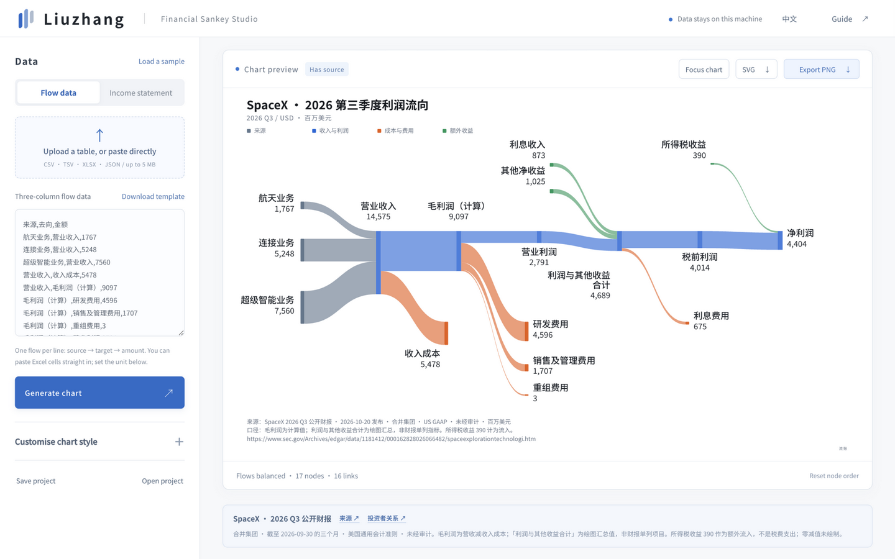

# 流账 · 财报桑基图生成器

纯静态中文工作台与独立 JavaScript API。数据只在本机处理，没有外部 API、账号连接、分析追踪或 CDN。输入规范化后的任意公司财报，或三列流向数据；不自动读取 PDF、OCR 或散乱自然语言。

<p align="center">
  
</p>

上图是载入 SpaceX 2026 Q3 官方财报后的默认状态：营收从左汇入，成本与费用向下流出，净利润靠右；绿色是额外收益。图下注明数据来源与口径，底部状态条给出「流向平衡 · 17 个节点 · 16 条流向」的守恒结论。

- [财报数据规范](docs/financial-format.md)：显式 role / stage / mainChain 与利润表阶段定义。
- [API、CLI 与模块边界](docs/api.md)：无需打开页面即可输出 SVG。
- [本地运行与源码说明](docs/local-setup.md)：版本溯源、离线运行、数据不随源码迁移的边界。
- [外置官方样例](examples/)：SpaceX 2026 Q3、Meta 2026 Q3 与 Anthropic 2026 H1（S-1）。来源与计算说明随图导出，不参与核心逻辑。

## 使用

Node.js 22+：`npm ci`、`npm test`、`npm run build`。静态产物在 `dist/`。

```sh
node scripts/render-financial.mjs examples/spacex-2026-q3.json --output chart.svg
```

页面支持 CSV / TSV 粘贴上传、XLSX 多工作表、两种结构化财报 JSON、本地项目保存、SVG / PNG 导出、纯色与渐变、显示增强最小线宽及关闭选项。

## 诚实的数据边界

三列表只接受非负无环流向。规范化财报可明确建模税收收益、负调整与经营/净亏损；亏损使用有说明的非现金会计差额桥，不是额外收入。缺失、混币种/单位、无法精确保留的十进制总和均明确报错，不取绝对值掩盖问题，不偷偷补数或换汇。不平衡可预览，必须修正后才能导出。

旧 JSON 数据、配色与明确自动布局选择保留。最近项目仍缓存在原浏览器 localStorage 键中；打开或导入不会上传其内容。

## 验证

保留 v10 全部节点/流带几何快照，上沿输出、窄直角矩形、真实比例、自然左右分支和细线显示均做回归。测试包括多种合成财报结构、重命名语义不变、亏损恢复、小数、零值、混合币种、异常守恒、恶意文本、项目读写、CSV/XLSX、CLI 和 UI。合成数据只在 `fixtures/` 用于测试，不作为页面公司示例；`fixtures/us/` 收录六份经 SEC EDGAR XBRL 渲染报表逐行核验的真实美股财报（Apple、Microsoft、NVIDIA、Alphabet、Amazon、Intel），同样只作测试输入，派生/残差行项在各文件 notes 中明确标注。

`src/core/index.js` 是唯一的公共 API。源码与构建产物按小步提交并同步远端，静态包与保存版本使用相同 commit。
